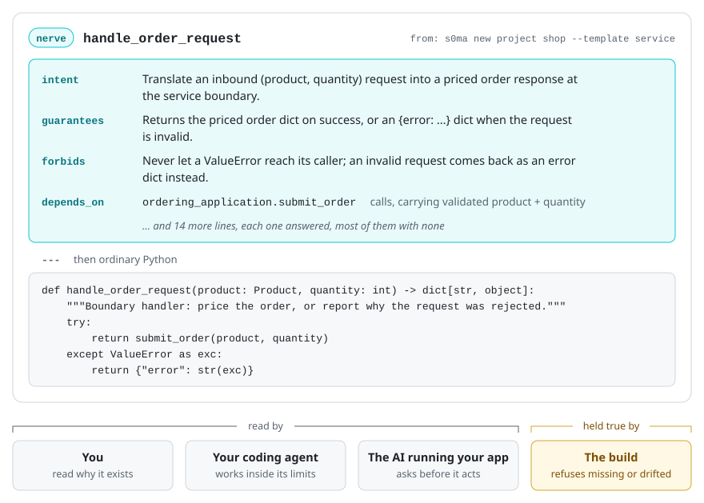
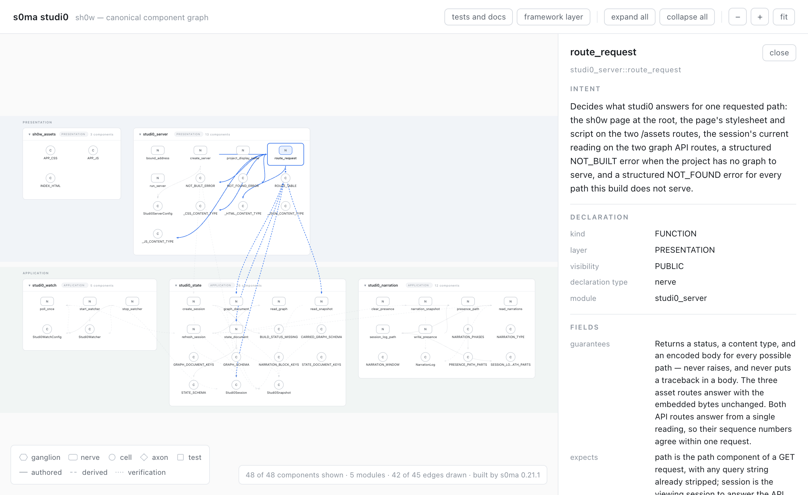
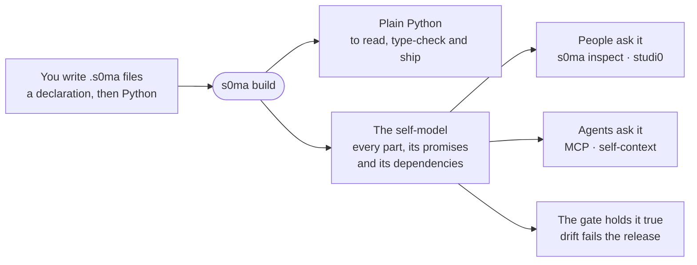

<div align="center">

# s0ma

**Software that explains itself to you and your AI**

<sub>by</sub> <a href="https://github.com/kn0w-thyself"><picture><source media="(prefers-color-scheme: dark)" srcset="docs/media/readme/kn0wthyself-wordmark-dark.svg"></picture></a>

[](https://github.com/kn0w-thyself/s0ma/actions/workflows/ci.yml)
[](https://github.com/kn0w-thyself/s0ma/releases/latest)


[See it work](#see-it-work) · [How it works](#how-it-works) · [Install](#install) · [Quick start](#quick-start) · [Is it for you?](#is-s0ma-for-you) · [Documentation](#documentation)

</div>

Your AI doesn't know what you know about your code: why each part exists, what
it promises, what it must never do. So you explain it again every session, or
it guesses.

s0ma moves that knowledge into the code. Each part declares its purpose, its
promises and its limits beside its Python, and the build refuses a part that
says nothing or a description that has drifted. You, your coding agent and the
AI running your app all read the same thing on demand, so nothing has to be
re-inferred from the source each session. s0ma contains no LLM and needs none.

<p align="center">
<picture><source media="(prefers-color-scheme: dark)" srcset="docs/media/readme/nerve-anatomy-dark.svg"></picture>
</p>
<p align="center"><sub>One real part of the project that <code>s0ma new project shop --template service</code> creates, drawn from its build record. The teal block is what a person wrote about it. The rest is ordinary Python.</sub></p>

## What you get

- **Context that cannot rot.** A notes file for your agent goes stale without
  anyone noticing. Here the description compiles with the code: an undescribed
  part fails the build, and drift fails the release gate.
- **One answer for every reader.** `s0ma inspect`, studi0, a Python API and an
  MCP server all answer from the same declarations: what exists, what it
  promises, what it depends on and what a change would break.
- **Agents that start informed.** A coding agent reads what each part is for
  instead of reconstructing it from source. An agent operating the running
  application is handed the same facts, as quoted data and never as
  instructions.
- **Ordinary Python, adopted gradually.** The build emits plain `.py` that you
  can read, type-check and ship, and an existing codebase converts a module at
  a time.

## See it work

**It explains itself.** Ask a module what it is and what it leans on. The
answer comes from the project's own build record.

<p align="center">
  
</p>

**It refuses to drift.** Somebody edits a generated file by hand. The build
refuses to overwrite it, and `--force` says out loud which copy survives.

<p align="center">
  
</p>

**You can look at it.** studi0 draws a project from its build record. Here it
is drawing its own source, with one part selected. Nothing on the page is
inferred.

<p align="center">
  
</p>

The recording script runs every command in these clips a second time and
checks the result, so what is shown is what happens.

## How it works



You write `.s0ma` files. A declaration says what a part is for, what it
expects, what it guarantees and what it must never do. Then comes a line of
three hyphens, and then ordinary Python:

```s0ma
nerve greet :: DOMAIN
    kind: FUNCTION
    visibility: PUBLIC
    intent: "Return a greeting for the name it is given."
    expects: "A name, as text."
    guarantees: "Returns a greeting that contains the name."
    forbids: none
    ...
    ---
    def greet(name: str) -> str:
        """Return a greeting for the name it is given."""
        return f"Hello, {name}!"
```

This is an excerpt: the `...` stands for twelve more lines, nearly all of them
`none`, so that an unanswered question and an answer of nothing never look the
same. [Your first project](docs/getting-started/first-project.md) has the
whole file, and [the quick reference](docs/reference/quick-reference-readable.md)
has every line a declaration can carry.

`s0ma build` turns the source into plain `.py` beside a machine-readable
record of everything declared, which s0ma calls the self-model. `s0ma check`
reads the sources, writes nothing, and is cheap enough to run constantly.
Because a part has to be declared to exist, the record cannot drift from the
code without something refusing to build.

The names come from the nervous system, which was the design model: s0ma
connects a brain, such as an LLM, to the body of software it acts on.

| Word | What it is |
|---|---|
| `nerve` | A working part: a function, a class, a service. |
| `cell` | Where data lives. |
| `ganglion` | A part that watches and responds. |
| `axon` | A declared dependency between two parts. |

Plain Python works too: decorate with `@component` from `s0ma-core` and the
same registry, verifiers and query surfaces apply, with no `.s0ma` file
anywhere. And the self-model reaches past Python. s0ma compiles Python today,
and an outside service, a part in another language or a physical device is
declared from the Python side, so it is in the dependency graph rather than
left out of it. More languages are on the roadmap. Hardware starts at
[the patterns guide §31](packages/s0ma-dsl/docs/references/dsl_patterns_guide.md#31-embodying-physical-hardware-adr-003).

## Install

s0ma is **not on PyPI yet**. All four packages are published there from the
first release cut of this repository
([PRD](references/s0ma-prd.md) NFR-8). Until that lands, `pip install s0ma-core`
does not work and the way in is this repository. This section is the one place
that route is written down.

s0ma runs on macOS, Linux and Windows with native CPython 3.11 or newer. The
commands use [uv](https://docs.astral.sh/uv/).

```bash
git clone https://github.com/kn0w-thyself/s0ma.git && cd s0ma
uv sync --all-packages --all-extras   # one environment with all four packages
uv run s0ma doctor                    # what is installed here, and whether it is healthy
```

Working this way, every bare `s0ma` command on this page is `uv run s0ma …`
from the checkout. Or activate the checkout's `.venv` once and type them as
written.

<details>
<summary><b>Or build the wheels and install them into a project of your own</b></summary>
<br>

From the checkout:

```bash
uv build --package s0ma-core && uv build --package s0ma-dsl   # add --package s0ma-mcp / --package s0ma-studi0 as needed
```

Then, in your own project, add each wheel by path. Their inter-dependencies
name PyPI packages that do not exist there yet, so a resolver cannot find them
on its own:

```bash
uv add /path/to/s0ma/dist/s0ma_core-*.whl /path/to/s0ma/dist/s0ma_dsl-*.whl
```

Or `pip install` the same wheels into any virtual environment, `s0ma-core`
first. The globs assume a clean `dist/`: one wheel per package, at the version
you just built.

`s0ma-core` on its own is fully supported: the runtime, with zero hard
dependencies. `s0ma-dsl` adds the `.s0ma` compiler and the `s0ma` command,
`s0ma-mcp` adds the authoring server, and `s0ma-studi0` adds the visual
environment. The optional extras of `s0ma-core` are `[api]` for REST, `[mcp]`
for the introspection MCP server, and `[all]`.

</details>

## Quick start

With the checkout's environment active, make a project anywhere and ask it
what it is. This is the project in the picture and the clips above:

```bash
source .venv/bin/activate                              # Windows: .venv\Scripts\activate
cd .. && s0ma new project shop --template service && cd shop
s0ma check                           # does everything declared hold together?
s0ma inspect api_presentation        # ask a module what it is
s0ma studi0                          # look at it
```

Next, [getting started](docs/getting-started.md) is the full journey. It has
you break a generated file and watch the build refuse, leave a promise
unwritten and watch the release gate fail, and hand the self-model to the
application itself.

<details>
<summary><b>Read the full getting-started journey here</b></summary>
<br>

<!-- BEGIN GENERATED GETTING STARTED -->
## Getting started: prove the self-model is useful

This is the canonical cold-start journey for s0ma. It is embedded in the root
README and served to coding agents as `s0ma://guide/getting-started`; if either
copy differs, the repository gate fails.

**When not to use it.** s0ma is not the tool for a throwaway script, a project
with no Python in it, a project that cannot accept generated Python, or a team
unwilling to make component intent and boundaries part of its release
contract, and it is not a replacement for application tests or observability.
What s0ma is, who it is for and what each of its four packages does are on the
repository's front page, the root `README.md`.

### 1. Create a real project

<!--
Single-source rule (the G6 rule, narrowed to one route for the public
repository's first release). The route below is stated here and nowhere else:
this section is the canonical route summary, and the root README's generated
getting-started region is its byte-for-byte mirror. The route's mechanics —
the clone, the sync, the wheel build and the install into a project — live on
exactly one page, the root README's "Install" section, and every other page
points there rather than restating them. Do not add a second copy, and do not
restate the mechanics here: the rule is enforced by
packages/s0ma-dsl/tests/test_docs_guide_bindings.py.
-->

If the `s0ma` command is not installed yet, there is one way in today, and it
is written down once — **the source route**: clone this repository and build
from it. The root `README.md` "Install" section has the exact commands, both
for working inside the checkout and for building the wheels and installing them
into a project of your own. s0ma is not on PyPI yet: all four packages are
published there from the first release cut of the public repository (PRD
NFR-8), so until then `pip install s0ma-core` will not work.

Then create a project:

```bash
s0ma new project my-app
cd my-app
```

The command creates a feature-first project, authored `.s0ma` modules, a
load-bearing app map, tests, agent instructions, and a deterministic `build/`
directory. Generated Python is an artifact: edit `.s0ma`, never `build/*.py`.

Every kind of declaration a `.s0ma` file may hold, and every line each one
may carry, is on one page that the documentation build generates from the
language itself — the quick reference: `docs/reference/quick-reference-readable.md`
in a checkout, and `s0ma://guide/quick-reference` to a coding agent (the same
facts as data at `s0ma://guide/quick-reference.json`). Look a line up there
rather than guessing at it.

**Already have a codebase?** `s0ma new project` starts from an empty folder. An
application that already works takes the other way in, and it is written down
once: `docs/guides/retrofit-existing-codebase.md` walks the adoption ladder a
module at a time, over weeks, leaving the code working at every rung. The first
command is `s0ma adopt scan`. It reads the tree, says what is in it and what to
convert first, and writes nothing anywhere — no report file, no cache — so it
is safe to run before anything has been decided.

Run the static release checks. These commands do not import application code:

```bash
s0ma check --mode release
s0ma score --gate-mode release --gate
```

Both commands should exit zero in the fresh project. `--mode` selects authoring
strictness; `--gate-mode` is caller-owned evaluation policy. A project cannot
lower its own release threshold.

### 2. Ask the model what exists

Register the authoring server with your MCP client, then use the served tools:

```text
project_status(project_root="/absolute/path/to/my-app")
inspect_module(project_root="/absolute/path/to/my-app", module="core_domain")
```

`project_status` is the first call in an unfamiliar tree: it reports project
posture, modeled versus roster-only modules, build freshness, semantic debt,
runtime/runbook facts, and validated next actions. `inspect_module` returns the
canonical IR for `core_domain`, the tagged record of everything that file
declares, including its declared dependencies and structured
dependency-neighbor actions. The starter component has no component
dependency, and that empty edge set is useful evidence rather than an invented
relationship. As the project grows, follow the returned `inspect_module`
actions to inspect `depends_on` and `depended_by` neighbors before grepping.

If no MCP client is connected yet, the equivalent human-oriented survey is:

```bash
s0ma inspect --all
s0ma inspect core_domain
```

### 3. See the guardrail work

Make a harmless temporary edit to the generated file
`build/core_domain.py`—for example, add a comment—then run:

```bash
s0ma build .
```

The build must refuse with `GENERATED_FILE_DRIFT`: s0ma will not silently erase
a hand edit. Recover by discarding that generated-only edit and rebuilding from
the authored source:

```bash
s0ma build . --force
```

Now temporarily change the authored `guarantees:` value in
`src/core/core_domain.s0ma` to
`pending("replace this temporary release debt")`, then run:

```bash
s0ma check --mode release
s0ma score --gate-mode release --gate
```

Release evidence must fail: explicit pending semantic debt earns zero credit and
blocks release. Restore the original guarantee, run `s0ma check --mode release`
and `s0ma build .`, and both return green. The point is not the toy edit; it is
the proof that the self-model participates in what can ship.

### 4. Prove host reality explicitly

Static checks deliberately do not execute project code. The host probe runs
under the application's own Python, and a fresh project does not have one yet:
it has no environment and declares no dependencies. Give it both in one step —
from inside `my-app`, `uv add` the `s0ma-core` and `s0ma-dsl` wheels from the
Install section, which creates `.venv`, installs them, and names them in
`[project].dependencies` (the build's `HOST_RUNTIME_UNDECLARED` warning asks
for exactly that declaration; with pip, install the two wheels into a `.venv`
of your own and add the two names to `[project].dependencies` by hand). Then,
after reviewing and trusting the application, run the separate probe:

```bash
s0ma verify-host --gate-mode release --python .venv/bin/python
```

On Windows use `.venv\\Scripts\\python.exe`, or set a contained
`[tool.s0ma].venv_path`. Host verification imports trusted application modules
without a sandbox and may trigger their filesystem, process, or network side
effects, so it requires explicit approval. Release evidence is the pair: a
caller-pinned static gate and this host-runtime report; neither alone is a
release claim.

### 5. Put self-knowledge in the application

Every build emits a content-addressed `self_context.json` and bounded
`self_prompt_card.md`. An application can load them with
`s0ma.runtime.self_context()`, wire the verified `self_inspect` adapter into its
own toolset, and give the agent that operates it — the second way an agent
meets s0ma — a current component/dependency model.
Read `s0ma://guide/self-prompting` for the complete wiring and trust-boundary
example. Authored intents are quoted project data, never privileged
instructions.

You have now exercised the whole value loop: author intent, build deterministic
artifacts, orient from the model, inspect dependency facts, watch drift and
release debt block, and verify the result in the host environment.

Wondering what s0ma trusts, what it executes, and what it will never send
anywhere? That contract is written down: `docs/trust-model.md`.

See also `docs/troubleshooting.md` when a step here does not behave as
described, `docs/guides/packaging.md` when the project is ready to ship as a
wheel, and `docs/uninstall.md` for removing s0ma completely.

If anything here broke or was harder than it should have been, say so where it
will be seen and answered: open a
[bug report](https://github.com/kn0w-thyself/s0ma/issues/new/choose) for
something that is wrong, or start a
[discussion](https://github.com/kn0w-thyself/s0ma/discussions) for a question or
an idea. `CONTRIBUTING.md` at the repository root says where each kind of
message goes.
<!-- END GENERATED GETTING STARTED -->

</details>

**Already have a codebase?**
[Retrofitting an existing codebase](docs/guides/retrofit-existing-codebase.md)
is the way in: five rungs you can stop on and walk over weeks, not a rewrite.
The first command reads the whole tree, says what to convert first, and writes
nothing:

<p align="center">
  
</p>

## Is s0ma for you?

**Probably, if:**

- an AI works on your system, or runs it, and you want its answers to come
  from the project rather than from a guess;
- people join and leave, and *what does this do, and what breaks if I change
  it?* is a question you keep answering by reading code;
- you build agents, agent harnesses, AI-enabled applications, or autonomous
  software and hardware systems whose operator has to be able to ask the
  system what it is.

**Probably not, if:**

- the work is a throwaway script, or has no Python in it to declare the rest
  from;
- the codebase cannot accept generated Python files beside the sources you
  write;
- the team is unwilling to let a release fail on a part's purpose and
  boundaries. That is the whole mechanism, and without it s0ma is overhead.

One thing s0ma is not: a replacement for your tests or your production
monitoring. It tells you what the system is. It does not tell you it is
working.

## Packages

One repository, one lockstep version (**0.21.1**), four independently
installable packages, all Apache-2.0:

| Distribution | Module | What it is |
|---|---|---|
| [`s0ma-core`](packages/s0ma-core) | `s0ma` | The runtime: the registry every part is declared into, the verifiers, the lifecycle, and the surfaces that answer what exists and why. |
| [`s0ma-dsl`](packages/s0ma-dsl) | `s0ma_dsl` | The `.s0ma` language, its compiler, and the `s0ma` command line. |
| [`s0ma-mcp`](packages/s0ma-mcp) | `s0ma_mcp` | The authoring server a coding agent works through, over the Model Context Protocol. |
| [`s0ma-studi0`](packages/s0ma-studi0) | `s0ma_studi0` | studi0, the local visual environment (`s0ma studi0`), whose sh0w renderer draws a project's component graph from its build artifacts. **Early preview, with more coming.** |

Dependencies point one way: `s0ma-mcp` and `s0ma-studi0` depend on `s0ma-dsl`,
which depends on `s0ma-core`. `s0ma-core` stands alone with zero hard runtime
dependencies, so an application can take the runtime and nothing else.

**The spelling.** It is `s0ma` with a digit **zero**, everywhere, and
`studi0`, `sh0w` and `kn0wthyself` likewise. The letter-o spelling is a build
failure rather than a preference ([PRD](references/s0ma-prd.md) INV-1).

## For coding agents

Agents meet s0ma in two ways.

- **Building a s0ma application.** A coding agent reads what each part
  declares instead of reconstructing the system from source, and the
  guardrails refuse an undeclared or drifted change before a person sees it.
  It works with the `s0ma` command line, or through the authoring MCP server:
  `claude mcp add s0ma -- s0ma-mcp`.
- **Operating a s0ma application.** Every build emits a self-context. The
  running application loads it with `s0ma.runtime.self_context()` and hands
  it to the agent that operates it, as quoted project data and never as an
  instruction.

[`s0ma-mcp`](packages/s0ma-mcp/README.md) is itself a s0ma application,
served from its own self-model, which makes it the worked example of a
production s0ma project.

<details>
<summary><b>What the authoring server serves</b></summary>
<br>

<!-- BEGIN GENERATED MCP SURFACE -->
The served surface is generated from the committed MCP snapshot; its live names, annotations, and input/output schemas are checked in CI.

- **Tools:** `adopt_file`, `build_project`, `check`, `describe_server`, `init_project`, `inspect_module`, `learn_s0ma`, `migrate_ext`, `prepare_feedback`, `project_status`, `run_example`, `scaffold_module`, `submit_feedback`, `transpile`, `verify_host`.
- **Resources:** `s0ma://docs/concepts`, `s0ma://docs/index`, `s0ma://docs/journeys`, `s0ma://guide/errors`, `s0ma://guide/getting-started`, `s0ma://guide/patterns`, `s0ma://guide/quick-reference`, `s0ma://guide/quick-reference.json`, `s0ma://guide/self-prompting`, `s0ma://guide/survival-card`, `s0ma://guide/system-prompt`, `s0ma://meta/changelog`, `s0ma://meta/version`, `s0ma://project/runbook`, `s0ma://self/model`, `s0ma://spec/current`.
- **Prompts:** `author_module`, `diagnose_fault`, `feedback`, `fix_check_failures`, `migrate_project`.
<!-- END GENERATED MCP SURFACE -->

</details>

## Status

**Public beta, pre-1.0.** A minor release may break something, and an entry
in [one changelog](CHANGELOG.md) announces it. One habit covers most of the
risk: **pin the version, and commit the build.** The full answer is
[what can change, and how you will know](docs/stability.md).

Nothing built from this repository contacts a service unless you ask it to.
[What s0ma trusts](docs/trust-model.md) lists every request s0ma can make and
how to stop each one.

Feedback is the point of a beta. If something broke or was harder than it
should have been, open a
[bug report](https://github.com/kn0w-thyself/s0ma/issues/new/choose) or start a
[discussion](https://github.com/kn0w-thyself/s0ma/discussions).

## Documentation

**Start here: [the map of record](docs/README.md).** It is the one index:
every document this repository keeps, what it is, who it is written for, and
which automatic check keeps it honest.

The same map is reachable without leaving your terminal: `s0ma docs` opens it,
`s0ma docs list` walks it by category, and `s0ma docs show <topic>` answers
one question from it. A coding agent reads it as `s0ma://docs/index`.

## Contributing

Questions, bug reports and discussions are open to everybody and are the
contribution we most want. **Pull requests are by invitation during the
beta**, so raise the idea in an issue or a discussion first.
[CONTRIBUTING.md](CONTRIBUTING.md) says where each kind of message goes,
[SECURITY.md](SECURITY.md) is the private route for a security problem, and
everyone taking part follows the [code of conduct](CODE_OF_CONDUCT.md).

```bash
uv sync --all-packages --all-extras   # one environment for the whole workspace
uv run python scripts/check.py        # the full gate, the single command CI runs
```

The [PRD](references/s0ma-prd.md) holds the product's purpose and binding
invariants. Read it before changing what s0ma *is*. Conventions for coding
agents are in [AGENTS.md](AGENTS.md).

## License

s0ma-core: Apache-2.0
s0ma-dsl: Apache-2.0
s0ma-mcp: Apache-2.0
s0ma-studi0: Apache-2.0
